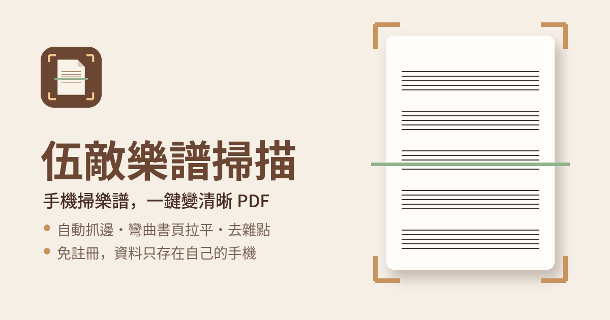

# 伍線譜樂譜掃描

免費、免註冊、沒有廣告和浮水印的手機掃描 App。專為樂譜設計，講義、筆記、書本、一般文件也一樣好用。

👉 **用手機打開：<https://andywu1101.github.io/scanner/>**

## 特色

- **對準就自動拍**：自動找出紙張，拿穩就按快門，翻一頁拍一頁，整疊文件很快掃完。
- **AI 精準框選紙張**：背景雜亂、紙張疊在一起也框得準，省去不斷編輯的麻煩。
- **書本攤開也能拍**：沿著書溝自動只框一頁，角被手指或釘書針遮住也能推算。
- **彎曲書頁拉平**：外框可以拉成弧線，貼合彎曲的頁面再拉平。
- **為樂譜調校的黑白模式**：去陰影、去雜點，文字、音符清楚銳利，五線譜的細線完整保留。另有灰階、彩色、原圖模式。
- **細部調整即時預覽**：整份文件統一調整，或只調單頁；改錯可以上一步／下一步。
- **橫拿手機也能拍**：拍好的頁自動轉正。
- **相簿匯入、匯出 PDF 與圖片**：直接傳 LINE、存到雲端，在平板、電腦上閱讀。
- **資料只存在你的手機**：所有處理都在手機上完成，掃描內容不會上傳。

## 開始使用

這是網頁 App（PWA），不用到 App Store 或 Google Play 下載。用手機瀏覽器打開網址，再「加入主畫面」，就能像一般 App 一樣使用。

**iPhone／iPad（Safari）**

1. 長按網址列，點最上方的「分享」（或點網址列的選單「⋯」找到分享）。
2. 往下找到並點「加入主畫面」。
3. 點右上角的「加入」。

**Android（Chrome）**

1. 點右上角的選單「⋮」。
2. 點「安裝應用程式」或「加到主畫面」。
3. 點「安裝」或「新增」。

> ⚠️ **請先加入主畫面，再開始掃描。** 在瀏覽器裡掃描的資料，不會出現在主畫面的 App 裡。

第一次開啟會下載影像引擎（約 10 MB）；第一次使用 AI 框選時會再詢問是否下載 AI 資料（約 32 MB）。下載後存在手機裡，之後沒有網路也能使用。

## 三種拍法

| | 即時掃描 | 高畫質拍照 | 相簿匯入 |
|---|---|---|---|
| 適合 | 一次掃很多頁 | 要最清楚的單頁 | 已經拍好的照片 |
| 操作 | 對準文件，穩定後自動拍，可連續多頁 | 開啟手機相機拍一張，再微調範圍 | 從相簿選照片，自動找出紙張 |
| 畫質 | iPhone 約 1200 萬畫素；Android 依手機 800～1600 萬畫素 | 相機全解析度 | 依原始照片 |

## 隱私

- 掃描的影像、文件都只存在這支手機的瀏覽器裡，不會上傳到任何伺服器，也不需要帳號。
- 網站使用 Cloudflare Web Analytics 統計匿名的瀏覽次數，不使用 Cookie，也不會讀取你的掃描內容。
- **刪除主畫面上的 App 會一併清除裡面的掃描**，重要的文件請先匯出成 PDF。

## 問題回報與支持

- 使用上有任何問題或建議，可以在 App 的封面或設定裡按「回報問題或建議」。
- 如果這個工具對你有幫助，歡迎從 App 封面的「小額贊助」支持後續開發與維護。

## 作者

伍祐恆 Heng-Heng Wu，鋼琴教師、音樂教育工作者。平常要掃樂譜、教材、講義，試遍各種掃描 App 都不滿意，於是自己做了這個工具。

## 版本紀錄

- **v3.0.1（2026 年 10 月）**：AI 框選全面加速（支援的手機會運用 GPU）、AI 書頁框選最佳化（攤開的書框得更準）、自動 AI 框選預設開啟（即時掃描、高畫質拍照、相簿匯入都適用）、框選畫面支援雙指縮放、加入主畫面說明新增影片教學。
- **v2.0（2026 年 10 月）**：正式版上線。
- **v1.x（開發期間）**：自動抓邊與透視校正、書溝分頁、四種增強模式、多頁管理與 PDF 匯出、AI 框選、曲線拉平、即時預覽調整、上一步／下一步、畫質分檔、iPad 與寬螢幕版面、橫拿拍攝等功能陸續完成。

## 使用的開源專案

感謝以下開源專案：

| 專案 | 用途 | 授權 |
|---|---|---|
| [OpenCV.js](https://opencv.org/) 4.10 | 紙張偵測、透視校正、影像處理 | Apache 2.0 |
| [ONNX Runtime Web](https://github.com/microsoft/onnxruntime) 1.30.0（備用 1.17.3） | 在手機上執行 AI 模型（可運用 GPU） | MIT |
| [U²-Net](https://github.com/xuebinqin/U-2-Net)（u2netp，ONNX 檔取自 [rembg](https://github.com/danielgatis/rembg)） | AI 框選 | Apache 2.0（rembg：MIT） |
| [SortableJS](https://github.com/SortableJS/Sortable) 1.15.3 | 頁面拖曳排序 | MIT |
| [QR Code Generator](https://github.com/kazuhikoarase/qrcode-generator)（Kazuhiko Arase） | 電腦版顯示網址 QR Code | MIT |

---

© 2026 伍祐恆，保留所有權利。
